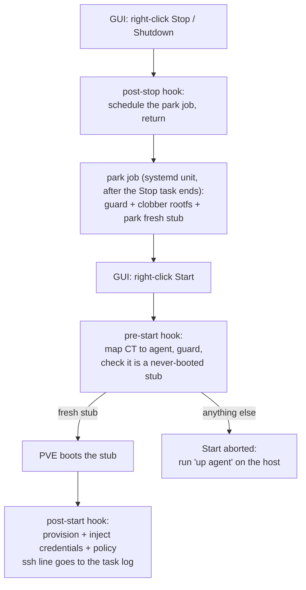

# AI-sandbox

Single-use, auto-rebuild Linux container (LXC) sandboxes for AI coding
agents on Proxmox VE. Each agent gets its own disposable container,
provisioned on every build with the agent's current CLI, its credential,
and a default-deny configuration: a contained place to let an agent work
with full outbound internet access, without handing it your machine.

AI-sandbox is the generalisation of
[mistral-sandbox](https://github.com/itsfja/mistral-sandbox), which
stays as it is. All of its safety machinery (ownership guard, work-loss
guard, rescue archive, egress firewall, GUI trap, self-update) is carried
over unchanged; what is new is that the agent is a pluggable **profile**
and that several agents can run side by side.

| Agent | Profile | Status |
| --- | --- | --- |
| Mistral Vibe CLI | `mistral` | available |
| Claude Code | `claude` | available |
| Claude Code on DeepSeek | `deepseek` | available |
| Gemini CLI | `gemini` | available |
| anything else | drop-in profile | planned (PTF 5) |

See [Roadmap](#roadmap) for what is coming and the design decisions behind it.

## Design

- **Single use** — nothing persists between sessions. `up` (or a GUI
  Start) never resumes an old container: it destroys any existing one and
  rebuilds from the template, so every session starts clean.
- **One instance per agent** — each agent has its own CTID, hostname
  (`ai-sandbox-<agent>`), MAC, credential store, and lock, so a Mistral
  sandbox and (later) a Claude sandbox can run at the same time without
  touching each other. One SSH keypair serves every instance.
- **Profiles** — everything agent-specific (CLI install, version check,
  credential injection, default-deny policy config, VS Code extension ID)
  lives in a small set of `profile_<agent>_*` functions; everything else
  is agent-neutral.
- **Internet-enabled** — unrestricted outbound net by default (minus your
  LAN, see egress below): the agent can download any tool it needs and
  search or fetch the web.
- **Credential store** — each agent's credential lives on the host in
  `/root/.ai-sandbox/<agent>/secrets.env` (mode 600) and is re-injected
  into every rebuild in the form that agent expects. It never lives in
  this repository.
- **SSH-kept** — a dedicated sandbox keypair is retained on the host
  (`/root/.ai-sandbox/ssh/ai-sandbox`), generated on the first build and
  injected into every rebuild of every instance. Override with
  `SSH_PUBKEY` to reuse an existing key instead.
- **MAC-kept** — each instance's MAC is generated once, retained on the
  host (`/root/.ai-sandbox/<agent>/mac`), and pinned on every rebuild, so
  one DHCP reservation per agent fixes its IP forever.
- **GUI-trapped** — the Proxmox GUI drives the lifecycle: right-click
  Stop = disk clobber + a freshly built, never-booted stub (about a
  minute after the Stop task ends); Start = boot that stub and provision
  it. Restart is not supported: use Stop, then Start. One shared `pct`
  hookscript shim serves every instance and maps the CT back to its
  agent by hostname.
- **Clobbered** — on stop, the rootfs is discarded (`CLOBBER=discard`) or
  zero-filled (`CLOBBER=zero`) and the CT is replaced by a pristine,
  unprovisioned stopped stub.
- **Ownership-guarded** — every destroy or clobber first verifies the CT
  carries the `ai-sandbox` tag and the instance hostname. Anything else
  at that CTID aborts loudly instead of being destroyed; in the GUI, the
  task fails closed.
- **Work-guarded** — no teardown silently incinerates unextracted work:
  a running sandbox is scanned for git repos with uncommitted changes,
  meaningful new files, or unpushed commits. Findings abort the teardown
  (interactive default-No; fail-closed when unattended) unless
  `FORCE=1`, and an approved teardown is rescue-archived with `vzdump`
  first.
- **Hardened** — every build injects the agent's default-deny config
  (connectors, MCP servers, and auto-approve all off) and a host-side
  Proxmox egress firewall that blocks your LAN. See
  [Connector & egress hardening](#connector--egress-hardening).
- **Self-updating** — build paths sha256-check the script against `main`
  and install the current copy when stale.
- **Configurable without your shell** — settings can live in
  `config.env` files on the host, so GUI Start/Stop (which run without
  your environment) honour them too.

## Requirements

- Proxmox VE 8.x; run on the host as root (uses `pct` / `pveam` / `pvesm`).
- A bridge with DHCP (default `vmbr0`).
- A storage pool for the rootfs (default `local-lvm`).
- Internet access from the host (the build downloads the container
  template, the toolchain, and the agent CLI).

## Quick start (step by step)

Every command below runs in a root shell on the Proxmox VE host itself.
The examples use the `mistral` agent; `/root/ai-sandbox.sh agents`
lists every agent this copy of the script knows.

```bash
sudo -i
```

### 1. Download the script to the host

```bash
curl -fsSL https://raw.githubusercontent.com/itsfja/AI-sandbox/main/ai-sandbox.sh -o /root/ai-sandbox.sh
chmod +x /root/ai-sandbox.sh
/root/ai-sandbox.sh          # prints usage; no side effects
/root/ai-sandbox.sh agents   # lists the agent profiles and their CTIDs
```

Prefer git? `git clone https://github.com/itsfja/AI-sandbox.git` and use
the script from the checkout; every later step is identical. A curl copy
keeps itself current (see [Self-update](#self-update)); a git checkout is
updated with `git pull` instead, and the script never rewrites it.

### 2. Add the agent's credential (one time per agent)

```bash
mkdir -p /root/.ai-sandbox/mistral && chmod 700 /root/.ai-sandbox
printf 'MISTRAL_API_KEY=paste_your_key_here\n' > /root/.ai-sandbox/mistral/secrets.env
chmod 600 /root/.ai-sandbox/mistral/secrets.env
```

What goes in `secrets.env` depends on the agent; see
[Agents](#agents). Never paste a real key anywhere except this file — not
into issues, PRs, chats, or screenshots. If you skip this step, builds
still work, but the agent falls back to its own interactive sign-in.

### 3. Check three host settings (two minutes)

```bash
pct list       # the agent's CTID (mistral: 1051) must not already be in use
pvesm status   # find your rootfs storage name; default expected: local-lvm
ip -br link show type bridge    # list bridges; default expected: vmbr0
```

Confirm the bridge actually carries working DHCP. Best signal: what your
existing CTs already use:

```bash
grep -H net0 /etc/pve/lxc/*.conf 2>/dev/null || echo "no existing CTs — use the DHCP probe below"
```

On a fresh node, probe the candidate bridge for a DHCP server without
creating any CT (one real DHCPDISCOVER is sent; the offered address is
never applied):

```bash
timeout 60 dhclient -1 -d -sf /bin/true -lf /dev/null -pf /tmp/dhcptest.pid vmbr0 \
  && echo "DHCP reachable on vmbr0" || echo "no DHCP answer on vmbr0"
```

Or skip the probe and treat `up`'s `container started but no IP` error
as the check: `purge` the half-built CT, fix DHCP, and run `up` again.

If anything differs from the defaults, put it in a config file so every
command — and the GUI — picks it up (see [Configuration](#configuration)):

```bash
printf 'STORAGE=my-pool\nBRIDGE=vmbr1\n' > /root/.ai-sandbox/config.env
chmod 600 /root/.ai-sandbox/config.env
```

### 4. Build the sandbox

```bash
/root/ai-sandbox.sh up mistral
```

The first run downloads the container template, generates the retained
SSH keypair, provisions the toolchain and the agent CLI, and deploys the
GUI hookscript shim — expect a few minutes. It ends with `sandbox ready.`
followed by the ssh line. If you do not see both lines, it failed: read
the message above them and check [Troubleshooting](#troubleshooting).

### 5. Get inside

```bash
/root/ai-sandbox.sh ssh mistral
```

That is shorthand for `ssh -i /root/.ai-sandbox/ssh/ai-sandbox root@<ip>`;
add a command to run just that (`/root/ai-sandbox.sh ssh mistral vibe --version`).
There is no root password: a plain `ssh root@<ip>` without the key asks
for one and never gets in. Then start the agent (`vibe` for Mistral).
Other doors in:

- `/root/ai-sandbox.sh shell mistral` on the **host** — a root shell in
  the CT (`pct enter`, no password).
- Your desktop or VS Code: see [From your desktop](#from-your-desktop-export)
  and [VS Code](#coding-from-the-sandbox-in-vs-code-remote-ssh).
- The Proxmox GUI **console** never opens, by design: root has no
  password and root SSH is key-only.

### 6. When you are done

```bash
/root/ai-sandbox.sh down mistral
```

The disk is clobbered and the sandbox is parked as a fresh, stopped stub:
nothing from your session is recoverable from it. The credential store
and SSH keypair stay on the host. Next session: `up` again, or
right-click Start on the stub in the Proxmox GUI. `purge` removes the CT
from the tree entirely.

## Agents

Each agent is an instance with its own CTID, hostname, MAC, credential
store and lock. Defaults:

| Agent | CTID | Hostname | `secrets.env` | Policy file in the CT |
| --- | --- | --- | --- | --- |
| `mistral` | 1051 | `ai-sandbox-mistral` | `MISTRAL_API_KEY=<key>` → `/root/.vibe/.env` | `/root/.vibe/config.toml` (mode 400) |

Override an agent's CTID with `CTID=` in its `config.env`. Instances do
not share locks, so `up mistral` and a GUI Start of another agent can run
at once; a short shared lock only serialises first-time keypair
generation, the template download, and writing the hook shim.

`status` without an agent lists every ai-sandbox CT on the node:

```text
# /root/ai-sandbox.sh status
AGENT      CTID   STATE    IP              PROVISIONED
mistral    1051   running  192.168.3.77    yes
```

`PROVISIONED` (and `running, provisioned` in `status <agent>`) means the
last build finished every provisioning step; the mark lives in
`/root/.ai-sandbox/<agent>/provisioned` and is cleared by every rebuild,
park, and destroy. `NO` on a running CT means provisioning failed, which
the Proxmox task status does not show (see
[Troubleshooting](#troubleshooting)).

### Mistral (`mistral`)

- **Credential**: a **Vibe** key from chat.mistral.ai (Code > Vibe CLI),
  not a Studio key. Both authenticate against the API, but only a Vibe key
  carries the Vibe Code entitlement — a Studio key leaves every prompt
  failing with `Invalid API key` (see Troubleshooting). Only one Vibe key
  exists at a time: creating a new one revokes the previous one wherever
  it was used.
- **Inside**: `vibe` (the CLI) and `vibe-acp`; `/whoami` shows which
  credentials are in use, `/model` switches presets.
- **VS Code extension**: `mistralai.mistral-vibe-code`; it reads the
  injected `/root/.vibe/.env`, so it comes up authenticated.

### Claude Code (`claude`)

CT 1052, hostname `ai-sandbox-claude`.

- **Credential**, one line in `/root/.ai-sandbox/claude/secrets.env`:
  - `ANTHROPIC_API_KEY=...`: a Claude Console API key (API billing). The
    first interactive `claude` in each session asks once whether to use it.
  - `CLAUDE_CODE_OAUTH_TOKEN=...`: your Pro, Max, Team or Enterprise
    subscription. Create it with `claude setup-token` on any machine with
    a browser; it is valid for a year and only makes model requests, so
    claude.ai connectors and Remote Control are unavailable with it (they
    are off in the sandbox anyway).

  It is parsed, never executed, and written to the CT as the `env` block of
  `/root/.claude/settings.json` (mode 600), which the CLI and the VS Code
  extension both read. A value with characters no key or token contains is
  refused. If both lines are present, Claude Code uses the API key.
- **Policy**: `/etc/claude-code/managed-settings.json`, Claude Code's
  managed settings, which nothing in the CT's user or project settings can
  override. By default it disables bypass-permissions and auto mode
  (`AGENT_AUTO_APPROVE`), claude.ai connectors (`AGENT_CONNECTORS`), and
  every MCP server a user or project adds (`allowedMcpServers: []`,
  `enableAllProjectMcpServers: false`; `AGENT_MCP`).
- **Install**: the native installer (`claude` on `PATH`, no Node). Native
  installs update themselves in the background, so a clone runs at least
  the version the last bake installed.
- **VS Code extension**: `anthropic.claude-code`.

### Claude Code on DeepSeek (`deepseek`)

CT 1054, hostname `ai-sandbox-deepseek`. The same Claude Code CLI, policy
and VS Code extension as `claude`, pointed at DeepSeek's
Anthropic-compatible API (`https://api.deepseek.com/anthropic`) instead of
Anthropic's. It runs alongside `claude`, so you can compare the two.

- **Credential**: `DEEPSEEK_API_KEY=...` in
  `/root/.ai-sandbox/deepseek/secrets.env`, a key from
  [platform.deepseek.com/api_keys](https://platform.deepseek.com/api_keys)
  (pay-as-you-go API billing with DeepSeek). Parsed, never executed, and
  written with the endpoint as the `env` block of
  `/root/.claude/settings.json` (mode 600): `ANTHROPIC_BASE_URL`,
  `ANTHROPIC_AUTH_TOKEN` and the model variables below. No Anthropic
  account or key is involved.
- **Models**: DeepSeek accepts `deepseek-v4-pro` and `deepseek-flash`. By
  default the main model (and Claude Code's Opus and Sonnet slots) is
  `deepseek-v4-pro`, and the Haiku slot and subagents use `deepseek-flash`.
  Change them in `/root/.ai-sandbox/deepseek/config.env`:

  ```bash
  DEEPSEEK_MODEL=deepseek-flash[1m]     # main model; [1m] = Claude Code's 1M-context mode
  DEEPSEEK_SMALL_MODEL=deepseek-flash   # Haiku slot and subagents
  ```

  `/model` inside a session still switches between the slots.
- **Limits**: these come from DeepSeek's side, not the sandbox. Prompt
  caching is ignored, so long sessions cost more than the token count
  suggests. MCP fields are ignored (MCP is off here anyway). Images in
  earlier turns are refused or dropped depending on the model. Web search
  works through DeepSeek's own search tool, billed as extra tokens.
- **Policy, install, VS Code**: as for `claude`. A golden baked before this
  profile existed has no `deepseek` entry, so the first `up deepseek` is a
  full build until the next `bake`. The bake installs Claude Code once for
  both profiles.

### Gemini CLI (`gemini`)

CT 1053, hostname `ai-sandbox-gemini`.

- **Credential**: `GEMINI_API_KEY=...` in `/root/.ai-sandbox/gemini/secrets.env`,
  a key from Google AI Studio (Get API key). Parsed, never executed, and
  written to `/root/.gemini/.env` (mode 600); the user settings select
  API-key sign-in so the first run does not ask. A Google-account login
  (OAuth) is not kept between rebuilds, so the key is the supported route.
  Gemini CLI loads no `.env` file at all in a folder you have not trusted
  (its "safe mode"), not even `~/.gemini/.env`, so a small launcher at
  `/usr/local/bin/gemini` reads the key from that one sandbox file and
  starts the real CLI. Folder trust stays on: an untrusted project's own
  `.env` and settings are still ignored. Interactive `gemini` asks once
  whether to trust a folder; headless `gemini -p` in an untrusted folder
  refuses to run, so scripts pass `--skip-trust` (or trust the folder first).
- **Policy**: `/etc/gemini-cli/settings.json`, the system settings file,
  which overrides user and project settings. By default it disables YOLO
  mode and "Always allow" (`security.disableYoloMode`,
  `security.disableAlwaysAllow`, `admin.secureModeEnabled`;
  `AGENT_AUTO_APPROVE`), MCP servers (`mcp.allowed: []`,
  `admin.mcp.enabled: false`; `AGENT_MCP`), and extensions, Gemini's
  add-ons, which can bring their own tools and MCP servers
  (`admin.extensions.enabled: false`, `security.blockGitExtensions`;
  `AGENT_CONNECTORS`).
- **Install**: Node.js 22 LTS from NodeSource when the CT has no Node 20+
  (Debian 12 ships 18), then `npm install -g @google/gemini-cli`. Node
  ends up in the golden template, so every agent's sandbox has it.
- **VS Code extension**: `google.gemini-cli-vscode-ide-companion`.

### Writing a profile

Until drop-in profiles land (PTF 5), a new agent is six functions in
`ai-sandbox.sh`, named `profile_<agent>_<part>`:

| Part | Job |
| --- | --- |
| `meta` | set `PROFILE_CTID`, `PROFILE_LABEL`, `PROFILE_VSCODE_EXT` |
| `install` | print a bash snippet that installs the CLI (runs in the CT as root after the base toolchain; `/root/.local/bin` is on `PATH`) |
| `verify` | print the command that proves the CLI works, e.g. `foo --version` |
| `credentials` | push `$SECRETS_FILE` into the CT in the agent's native form (use `ct_push_file <src> <dest> <mode>`) |
| `policy` | write the default-deny config from `AGENT_CONNECTORS`, `AGENT_MCP`, `AGENT_AUTO_APPROVE` (use `bool_word on\|off` → `true\|false`) |
| `credential_paths` | print the in-CT path(s) `credentials` writes, one per line; `bake` refuses to template an image where any of them exists |
| `credentials_hint` | *optional*: tell the user how to create `secrets.env` when it is missing |

The Mistral profile near the top of the script is the reference.

## Configuration

Settings come from, highest precedence first:

1. the environment of the command (`CORES=8 /root/ai-sandbox.sh up mistral`)
2. `/root/.ai-sandbox/<agent>/config.env` — one agent
3. `/root/.ai-sandbox/config.env` — every agent
4. the built-in default

The config files hold plain `KEY=value` lines (optionally quoted;
`#` comments and blank lines are fine). They are **parsed, never
executed** — no `$(...)`, no variable expansion — and refused unless
owned by root and not group- or world-writable. `AGENT` and `STATE_DIR`
cannot be set from a file.

Prefer the files for anything lasting: GUI Start/Stop run the hook
without your shell's environment, so only the files reach them.

Host state layout (`STATE_DIR`, default `/root/.ai-sandbox`):

```text
/root/.ai-sandbox/
├── config.env               optional, every agent
├── ssh/ai-sandbox[.pub]     sandbox keypair (generated on first build)
└── <agent>/
    ├── config.env           optional, this agent
    ├── secrets.env          the agent's credential (mode 600)
    ├── mac                  retained MAC (generated on first build)
    └── provision.sh         optional per-agent provisioning hook
```

Settings (all optional):

| Variable | Default | Meaning |
| --- | --- | --- |
| `CTID` | per profile (mistral 1051) | the agent's fixed container ID |
| `CORES`, `RAM_MB`, `SWAP_MB`, `DISK_GB` | 4, 4096, 2048, 40 | container size |
| `STORAGE` | `local-lvm` | rootfs storage |
| `BRIDGE` | `vmbr0` | network bridge (needs DHCP) |
| `TEMPLATE` | newest Debian 12 | e.g. `local:vztmpl/debian-12-standard_...tar.zst` |
| `SSH_PUBKEY` | managed keypair | use an existing public key instead |
| `SSH_KEY_FILE` | `STATE_DIR/ssh/ai-sandbox` | where the managed keypair lives |
| `MAC_FILE`, `CT_MAC` | `STATE_DIR/<agent>/mac` | retained MAC store / pin a specific MAC |
| `SECRETS_FILE` | `STATE_DIR/<agent>/secrets.env` | the agent's credential store |
| `HOOK` | `on` | attach the GUI lifecycle hookscript |
| `CLOBBER` | `discard` | post-stop rootfs wipe: `discard` / `zero` / `off` |
| `SANDBOX_TAG` | `ai-sandbox` | ownership tag enforced by the guard |
| `EXPORT_DIR` | `/root/ai-sandbox-export/<agent>` | where `export` writes the desktop bundle |
| `HOST_IP` | first of `hostname -I` | host address in `export`'s scp hint |
| `AUTO_UPDATE` | `on` | build-path self-check against `main` |
| `RAW_URL` | this repo's `main` | where the self-check fetches from |
| `FORCE` | `0` | `1` = proceed through the work guard without prompting (still rescue-archives) |
| `RESCUE` | `1` | take the pre-teardown rescue archive |
| `RESCUE_STORAGE` | `auto` | ordered list of backup storages; `auto` = first with backup content |
| `RESCUE_KEEP` | `2` | rescue archives of the CT to keep |
| `AGENT_HARDEN` | `on` | inject the agent's default-deny policy config |
| `AGENT_CONNECTORS` | `off` | allow account/app connectors |
| `AGENT_MCP` | `off` | allow MCP servers |
| `AGENT_AUTO_APPROVE` | `off` | allow auto-approve / YOLO / bypass modes |
| `FIREWALL` | `on` | attach `firewall=1` and manage `/etc/pve/firewall/<CTID>.fw` |
| `EGRESS_POLICY` | `lan-block` | `lan-block` / `strict` / `off` |
| `EGRESS_ALLOW` | — | comma-separated IPs/CIDRs allowed outbound |
| `EGRESS_DENY` | — | extra CIDRs `lan-block` drops — set it to your site's public IPv6 prefix (e.g. your /48) |
| `FW_DIR` | `/etc/pve/firewall` | Proxmox firewall config directory |
| `STATE_DIR` | `/root/.ai-sandbox` | host state root (environment only) |
| `GOLDEN_CTIDS` | `1048,1049` | the two CT IDs `bake` alternates between (global config only) |
| `BAKE_AGENTS` | `all` | comma-separated agents whose CLIs `bake` installs (global config only) |
| `MODE` | `auto` | how sessions are built: `auto` (linked clone of the golden when it has this agent, else full rebuild), `clone` (clone or refuse), `rebuild` (always the full build) |
| `BAKE_SCHEDULE` | `Sun *-*-* 03:00:00` | when `timer on` bakes: a systemd `OnCalendar` expression (global config only) |
| `TOPUP` | `off` | `on` = re-run the agent's CLI installer on a clone at spawn, for the latest release |
| `DEEPSEEK_MODEL` | `deepseek-v4-pro` | `deepseek` only: main model (Opus and Sonnet slots) |
| `DEEPSEEK_SMALL_MODEL` | `deepseek-flash` | `deepseek` only: Haiku slot and subagents |

## Golden template (bake)

`bake` does the expensive build once: a CT from the Debian template, the
baseline toolchain, and every agent's CLI (`BAKE_AGENTS`). It then strips
what no session may inherit (SSH host keys, machine-id, root's
`authorized_keys`, the provisioning script, caches), **refuses** if any
profile's credential path exists in the image, stamps it
(`/etc/ai-sandbox-golden`: date, agents, CLI versions), and turns it into
a Proxmox template:

```bash
/root/ai-sandbox.sh bake
/root/ai-sandbox.sh status      # ... golden: CT 1048 template (current), baked=...
```

Two slots, `GOLDEN_CTIDS` (default `1048,1049`), are used alternately.
Proxmox cannot destroy a template while linked clones still use its base
disk, so a bake never touches the current golden: it builds into the
other slot, replacing the old template there only when no CT's rootfs
still references it. If sandboxes still run from it, the bake stops and
names them; rebuild them (`up`, or GUI Stop) and bake again. A failed bake
leaves the current golden as it was, and the half-built CT stopped in the
other slot for inspection (`status` flags it; the next bake replaces it).

The template needs rootfs storage that supports linked clones: `lvmthin`
(like `local-lvm`), `zfspool` or `rbd`. Its hostname is
`ai-sandbox-golden`, so `golden` cannot be an agent name; it carries no
hookscript, and the GUI hook ignores it.

### Sessions as linked clones

Once a golden exists, every session is a **linked clone** of it: `up`,
`down`/GUI Stop (the parked stub) and `reset` clone instead of building,
so a fresh sandbox takes seconds and every session from one bake starts
from the same image. Per session, only what must be unique is added:
fresh SSH host keys, root's authorized key, the agent's credential and
policy, and your [provisioning hooks](#provisioning-hooks). The clone
gets this instance's own CPU/RAM, pinned MAC, firewall, tag and
hookscript; `DISK_GB` can grow the golden's disk size but not shrink it.

- `MODE=auto` (default) clones when the current golden has the agent baked
  in and falls back to a full rebuild, with a note, when it does not
  (no bake yet, or a new agent since the last bake). `MODE=clone` refuses
  instead of falling back; `MODE=rebuild` always builds from scratch.
- CLIs are as fresh as the last bake. `TOPUP=on` re-runs the agent's
  installer at spawn when you need today's release.
- After a bake, parked never-started stubs are moved onto the new golden
  right away. Running sandboxes stay on the golden they were cloned from
  until their next park or `up`; `status <agent>` shows which
  (`built from: golden CT 1048 (current)`).
- A linked clone lives on the golden's storage, whatever `STORAGE` says.

### Weekly bake (timer)

```bash
/root/ai-sandbox.sh timer on     # installs + enables ai-sandbox-bake.timer
/root/ai-sandbox.sh timer        # schedule, next run, last result
/root/ai-sandbox.sh timer off    # disables + removes it
```

`timer on` writes `ai-sandbox-bake.service` (oneshot, runs this script's
`bake`) and `ai-sandbox-bake.timer` to `/etc/systemd/system`: weekly at
`BAKE_SCHEDULE` (default Sunday 03:00), up to 30 minutes later at random,
and a missed run catches up at the next boot. Settings come from the
config files at run time. Logs: `journalctl -u ai-sandbox-bake.service`.

The timer runs the script at the path you ran `timer on` from: from a git
checkout, that is whatever branch is checked out. A weekly bake fails,
changing nothing, when both golden slots are busy: a sandbox has been
running from the older golden since two bakes ago. Rebuild it (`up`, or
GUI Stop) and the next run succeeds; `timer` shows the failure meanwhile.

## From your desktop (export)

Only the build (`up`) and teardown (`down`) have to run on the PVE
console; day-to-day ssh sessions can run from your desktop. After `up`:

```bash
/root/ai-sandbox.sh export mistral
```

writes a desktop bundle to `/root/ai-sandbox-export/mistral`: a copy of
the sandbox keypair, an `ssh-config` snippet (`ssh ai-sandbox-mistral`),
and a README.txt with per-OS instructions (Linux/macOS, Windows built-in
OpenSSH, and a PuTTY `.ppk` conversion). It prints the `scp` command to
fetch the tarball (on multi-homed hosts, override the printed address
with `HOST_IP=<reachable-address>`), then:

```text
mkdir -p ~/.ssh && chmod 700 ~/.ssh          # Linux/macOS
cp ai-sandbox ai-sandbox.pub ~/.ssh/
cat ssh-config >> ~/.ssh/config
ssh ai-sandbox-mistral
```

The keypair is shared by every agent, so exporting a second agent only
adds its `Host ai-sandbox-<agent>` block.

### Fix the IP on your DHCP server (recommended)

Each instance gets its address over DHCP, so the IP can change on every
rebuild — but its **MAC is permanent**: retained on the host and pinned on
every rebuild. Create one DHCP reservation per agent for its MAC, and the
same IP comes back for every future rebuild; `ssh ai-sandbox-<agent>`
then works without touching your ssh config again.

```bash
cat /root/.ai-sandbox/mistral/mac       # the retained MAC
pct config 1051 | grep net0             # hwaddr=... on the host
```

`export` also prints it. The retained MAC is **locally administered**
(`02:...`, deliberately, so it never squats on a real vendor OUI). Some
routers flag such MACs as "private"/"unknown manufacturer"; that is
cosmetic. If your router genuinely objects, overwrite the MAC file with a
universally-administered MAC, or set `CT_MAC` in the agent's config.env.

Notes:

- **The keypair is permanent**: one export unlocks every future rebuild.
  Only the IP in `ssh-config` can go stale — re-run `export`, or use the
  DHCP reservation above.
- **Rebuilds mint fresh SSH host keys**, so the bundled `ssh-config`
  pins `StrictHostKeyChecking no` for the sandbox Host only. With a
  hand-rolled config, expect `REMOTE HOST IDENTIFICATION HAS CHANGED`
  after each rebuild; clear it with `ssh-keygen -R <ip>`.
- `export` needs a running sandbox (it embeds the current IP) and the
  managed keypair; with an `SSH_PUBKEY` override, export your own key.
- Honest cost: the private key then also exists in the export dir and on
  your desktop. Delete the export dir after fetching the tarball.

## Coding from the sandbox in VS Code (Remote-SSH)

The `ssh ai-sandbox-<agent>` alias also works as a VS Code remote: the
editor UI runs on your desktop, the
[Remote - SSH](https://marketplace.visualstudio.com/items?itemName=ms-vscode-remote.remote-ssh)
extension connects through the same pinned ssh config, and the agent's
own extension (where it has one) runs inside the container over the same
credentials as the CLI. `vscode-server` and extensions live inside the
CT and die with every rebuild, by design.

Setup (desktop side, once):

1. Set `remote.autoForwardPorts` to `false` in your VS Code settings
   **before the first connect**, so ports opened inside the sandbox are
   not forwarded to your desktop's localhost.
2. **Remote-SSH: Connect to Host**, pick `ai-sandbox-<agent>`. The first
   connect installs `vscode-server` into the CT (a minute or two).
3. Make the agent's extension install itself on every connect: add its
   marketplace ID (`export` prints it) to `remote.SSH.defaultExtensions`
   in the same settings.json:

   ```json
   "remote.SSH.defaultExtensions": ["mistralai.mistral-vibe-code"]
   ```

4. Optionally pin the remote platform so a fresh desktop never asks:

   ```json
   "remote.SSH.remotePlatform": { "ai-sandbox-mistral": "linux" }
   ```

### One-command reconnect (desktop scripts)

`vscode-connect.sh` (Linux/macOS) and `vscode-connect.ps1` (Windows)
refresh the desktop ssh entry for one agent and open VS Code straight
into it:

```bash
# Linux/macOS; PVE_HOST must be ssh-reachable from the desktop
PVE_HOST=root@192.168.3.188 bash vscode-connect.sh mistral              # opens /root
PVE_HOST=root@192.168.3.188 bash vscode-connect.sh mistral /root/work   # another folder
```

```powershell
# Windows (PowerShell; ssh/scp are built in from Windows 10)
$env:PVE_HOST = 'root@192.168.3.188'
.\vscode-connect.ps1 mistral
```

To set `PVE_HOST` permanently: `[Environment]::SetEnvironmentVariable('PVE_HOST', 'root@192.168.3.188', 'User')`
in PowerShell (then open a new window), or `export PVE_HOST=...` in
`~/.bashrc` / `~/.zshrc`.

What a run does:

- Fast path: tries `ssh ai-sandbox-<agent>` as-is; if it works (say, a
  DHCP reservation pins the IP), the Proxmox host is never contacted.
- Stale path: asks `$PVE_HOST` for the current IP (`ai-sandbox.sh ip
  <agent>`), rewrites **only** its own marked
  `# BEGIN/END ai-sandbox-<agent>` block in your ssh config (other hosts
  and other agents' blocks are untouched), fetches the permanent private
  key once if missing, waits for ssh, then opens
  `code --folder-uri vscode-remote://ssh-remote+ai-sandbox-<agent>/root`.

Overrides: `AGENT` (instead of the first argument), `PVE_SCRIPT`,
`PVE_KEY`, `SSH_ALIAS`. The account at `PVE_HOST` must be able to read
the managed key (root by default).

Per-rebuild tax: every rebuild wipes `vscode-server` and the extension;
reconnecting reinstalls them. That is dev-tooling churn, not lost work.
Do not preinstall `vscode-server` in [`provision.sh`](#provisioning-hooks):
it self-installs, version-matched to your desktop editor.

Security habits for the remote path:

- ssh from the desktop is the only door; never expose CT services to the
  LAN to work around friction.
- Keep the remote workspace **untrusted** unless a task truly needs
  trust, and decline extension installs that workspace content
  recommends.
- Read shell-command approvals before allowing them; never adopt an
  always-allow option.
- `down` when you are done for the day; never leave an idle VS Code
  remote session connected overnight to a live sandbox.

## GUI-driven lifecycle (Proxmox right-click)

With `HOOK=on` (the default), each sandbox CT carries the shared `pct`
hookscript, so the Proxmox GUI becomes the front end:



| GUI action | What actually happens |
| --- | --- |
| Start | boots the pristine stub left by the last Stop / `down`, then provisions it; the Start task stays busy until provisioning finishes — open its log for the `ssh -i ...` line. A CT that has booted since it was built is refused (see below) |
| Stop / Shutdown | the post-stop hook hands the park to a transient systemd unit, `ai-sandbox-park-<agent>-<CTID>`, and the Stop task ends. About a minute later that unit has clobbered the rootfs (`CLOBBER`) and replaced the CT with a freshly built, never-booted stub. Progress: `journalctl -u ai-sandbox-park-<agent>-<CTID>`; `status <agent>` shows it too |
| Restart | **not supported**: its Start half arrives while the park is still running and is refused. Use Stop, wait for the park (about a minute), then Start |
| Snapshot / Clone / Migrate / Backup / Console | **not trappable** (no hook phase) — harmless, since the next Start purges everything |

The hook runs without your shell's environment: it finds the agent from
the CT's hostname (`ai-sandbox-<agent>`) and takes its settings from the
[config files](#configuration).

CLI and hooks coexist: a hook phase fires from *inside* the `pct` call
that triggered it. When `up` or `down` triggers one, that operation
already holds the agent's lock and does the phase's work itself — the
hook passes through with a one-line notice. When the GUI triggers it,
the hook takes the lock and does the work. Locks are per agent, so one
agent's build never makes another agent's hook pass through.

Why no hook rebuilds the CT: Proxmox holds the CT's config lock
(`/run/lock/lxc/pve-config-<CTID>.lock`) for the whole Start *and* Stop
tasks, every hookscript phase included, and `pct status` still reports
the CT as running during post-stop. Any `pct stop`, `destroy`, `create`,
`set` or `push` from a hook waits on its own task and times out.
(Provisioning therefore copies files in through `pct exec`, which does
not take that lock.) So post-stop only schedules the park with
`systemd-run` (a plain background job would be killed with the
container's cgroup); the park job takes the agent's lock, waits until
`pve-container@<CTID>` is inactive, and leaves the CT alone if it has
been started again by then. Every Stop / `down` leaves a freshly built stub and
records that it has never booted (`/root/.ai-sandbox/<agent>/pristine-stub`).
Start only boots a stub carrying that record and clears it as it boots.
Anything else — a CT that ran and was never parked (host crash, `pct
start` by hand), or a stub whose firewall settings changed since it was
parked — makes pre-start abort the Start with a message to run
`/root/ai-sandbox.sh up <agent>` on the host. `status <agent>` shows
which state a stopped CT is in.

Honest caveats:
- **Clobber levels.** `discard` is instant on SSDs but relies on TRIM —
  not guaranteed against chip-level forensics. `zero` is overwrite-grade
  at the cost of a few minutes per stop. Neither protects the *host's*
  credential stores: if physical theft is in your threat model, encrypt
  the PVE host with LUKS and keep each agent's credential dedicated and
  instantly revocable.

## Ownership guard

The script destroys and wipes a fixed CTID per agent on every rebuild, so
it refuses to touch any CT it cannot prove it owns. Ownership = the CT
carries both the instance hostname (`ai-sandbox-<agent>`) and the
ownership tag (`ai-sandbox`):

- **Created by this script** — tagged automatically at `pct create`.
- **Untagged, but with the instance hostname and the ai-sandbox
  hookscript** — recognised and tagged.
- **Anything else at that ID** — every `up`, `down`, `purge`, and GUI hook
  aborts with `refusing to touch CT <id>`: move that CT or set the
  agent's `CTID` to a free ID.

The guard fails closed: in the GUI, a refused Start or Stop aborts the
task with the refusal message in the task log.

## Connector & egress hardening

Isolating a container only contains **compute and local filesystem
state** — not information, as long as outbound connectors are enabled or
the container can probe internal network services. An agent can
introspect runtime, hostname, kernel, or hypervisor details and relay
them outward through any write-capable connector (a Slack message, a
Gmail draft, a GitHub issue). The boundary therefore has **three layers**.

### 1. In-container agent policy (automated on every rebuild)

Every build has the agent's profile write a default-deny config, owned by
root and read-only:

| Switch | Default | Mistral (`/root/.vibe/config.toml`) |
| --- | --- | --- |
| `AGENT_CONNECTORS` | `off` | `enable_connectors = false` |
| `AGENT_MCP` | `off` | `enable_mcp = false` |
| `AGENT_AUTO_APPROVE` | `off` | `enable_auto_approve = false` |

Open one up only when a task needs it, ideally per agent in its
config.env; `AGENT_HARDEN=off` skips injection entirely:

```bash
AGENT_MCP=on /root/ai-sandbox.sh up mistral
```

Honest caveat: the agent runs as `root` inside the CT, so this is a
**guardrail** against implicit connector use and auto-approved execution,
not a tamper-proof boundary against a malicious root process. Layers 2
and 3 enforce the hard boundary outside the CT.

### 2. Host-enforced Proxmox LXC firewall (outside container control)

The Proxmox firewall runs on the hypervisor bridge, so a root process
inside the sandbox cannot flush or disable it. With `FIREWALL=on`
(default), the script attaches `firewall=1` to `net0` and atomically
writes `/etc/pve/firewall/<CTID>.fw` **before** the container boots:

| `EGRESS_POLICY` | Inbound | Outbound |
| --- | --- | --- |
| `lan-block` *(default)* | `DROP` except SSH (`TCP 22`) | Allows DHCP, DNS (`53`), explicit `EGRESS_ALLOW`, and general internet; **DROPs** RFC1918 LAN (`10.0.0.0/8`, `172.16.0.0/12`, `192.168.0.0/16`), link-local/metadata (`169.254.0.0/16`), CGNAT (`100.64.0.0/10`), and IPv6 ULA/link-local (`fc00::/7`, `fe80::/10`) |
| `strict` | `DROP` except SSH (`TCP 22`) | `policy_out: DROP`; allows **only** DHCP, DNS, and `EGRESS_ALLOW` |
| `off` | Unmanaged | Unmanaged (`firewall=1` omitted; managed `.fw` removed) |

**Native IPv6 needs one setting.** `lan-block`'s built-in ranges are all
private. If your network has public IPv6, the sandbox picks up a public
address from your router like any other device, and every LAN device's
public IPv6 address is reachable through a rule set that only knows
private ranges. List your ISP-delegated prefix in `EGRESS_DENY`, once,
for every agent:

```bash
echo 'EGRESS_DENY=2a10:d585:7f66::/48' >> /root/.ai-sandbox/config.env   # your prefix
```

`up` and GUI Start warn when a sandbox has public IPv6 and `EGRESS_DENY`
is empty, and suggest the /48 from the sandbox's own address.
`EGRESS_ALLOW` still punches holes before it.

```bash
# Allow one internal LAN Git server while keeping the rest of the LAN blocked
EGRESS_ALLOW=192.168.3.50/32 /root/ai-sandbox.sh up mistral

# Strict egress: drop all outbound except an explicit proxy or IP allowlist
EGRESS_POLICY=strict EGRESS_ALLOW=192.168.3.10/32 /root/ai-sandbox.sh up mistral
```

**Datacenter firewall prerequisite:** Proxmox ignores per-CT `.fw` rules
unless the Datacenter firewall is enabled. The script never enables it
for you (that could lock you out of SSH or the web UI); `up` warns and
`status` reports it. To enable it safely: make sure management access
to ports `22` and `8006` is allowed, set **Datacenter > Firewall >
Options > Firewall: Yes**, then confirm `status <agent>` shows
`firewall: lan-block (enforced)`.

### 3. Account-level connectors (manual, per provider)

Connectors attached to your account at the provider live outside the
container and host, so the script cannot toggle them.

**Mistral (Vibe Work)** — connectors such as Slack, Gmail, Notion, the
GitHub App, Linear, Atlassian, Outlook, Box, SharePoint, and Stripe:

1. **Default-deny connectors per chat**: disable all connectors in the
   sandbox chat (**`+` > Tools**) while keeping them connected at the
   account level for normal work.
2. **Never pre-authorize connector functions ("Always allow").**
3. **Restrict write-capable connectors**: prefer read-only functions, or
   keep write-capable connectors disabled for sandboxed runs.
4. **Strip ambient context**: do not attach scheduled tasks, shared
   projects, libraries, or knowledge files that carry host, LAN, or
   hypervisor details into a sandbox session.

References: [Vibe Work Connectors](https://docs.mistral.ai/vibe/work/connectors),
[Vibe Work Safety and Approvals](https://docs.mistral.ai/vibe/work/safety-and-approvals).

## Subcommands

`/root/ai-sandbox.sh <command> [agent]` (or `AGENT=<agent>` in the environment):

| Command | Action |
| --- | --- |
| `up <agent>` | destroy any prior sandbox for that agent, rebuild, start, provision, print ssh line |
| `down <agent>` | clobber the disk and park a fresh stopped stub (GUI Start-able) |
| `purge <agent>` | destroy completely — no stub, gone from the tree |
| `reset <agent>` | `down` then `up` — fresh rebuild mid-work |
| `status [agent]` | one agent's CTID, state, provisioned or not, IP and firewall; every ai-sandbox CT when no agent is given |
| `ip <agent>` | the current IP (empty if not running) |
| `ssh <agent> [command]` | ssh in with the managed key (or run one command) |
| `shell <agent>` | root shell inside the CT (`pct enter`) |
| `export <agent>` | desktop bundle (keypair copy + ssh-config + per-OS instructions) |
| `agents` | list the agent profiles and their default CTIDs |
| `bake` | build a golden template with every agent's CLI in the free slot (see [Golden template](#golden-template-bake)) |
| `timer [on\|off]` | weekly `bake` via a systemd timer; no argument shows its schedule, next run and last result |
| `update` | self-update the script from `main` (previous copy kept beside it) |
| `hook` | internal — called by the PVE hookscript shim with (vmid, phase) |

## Self-update

The script is installed by hand, so local copies drift. Build paths
(`up` and GUI Start) therefore compare the running script's sha256 with
the copy on `main` (`RAW_URL`); when they differ, the current copy is
installed (after passing `bash -n`; the previous copy is kept as
`ai-sandbox.sh.bak`; the swap is an atomic `mv`) and the script re-runs
itself once. If the check cannot run (offline, timeout, invalid file) it
warns and proceeds. `AUTO_UPDATE=off` disables it;
`/root/ai-sandbox.sh update` does it on demand. A copy inside a git
checkout is never self-updated (that would rewrite a tracked file and
break the next `git pull`); update it with `git pull`.

Honest caveats: this is code that runs as root, fetched from GitHub
without further review — the trust boundary is this repo's `main`
branch. Hand-edited local copies are overwritten on the next build (your
edits land in the `.bak`); patch locally only with `AUTO_UPDATE=off`.

## Credentials (rotation and revocation)

Every build pushes the agent's `secrets.env` into the fresh container in
that agent's native form (for Mistral, `/root/.vibe/.env`). Rotate or
revoke at the provider at any time; to rotate locally, edit the host
file — the next rebuild picks it up. Use a credential dedicated to the
sandbox so revoking it never disturbs your other usage.

Both kinds of credential will be supported as profiles land: pay-per-use
**API keys**, and reusable **subscription tokens** where a provider
offers one. Interactive sign-ins are never baked into an image, so they
would be lost at every rebuild; a token in `secrets.env` is the way to
use a subscription.

## Provisioning hooks

Extra setup to run inside each fresh container after base provisioning
(toolchains, repo clones):

- `provision.sh` beside the script — every agent
- `/root/.ai-sandbox/<agent>/provision.sh` — one agent (runs second)

Keep them deterministic to keep rebuilds identical. (Unrelated to the
PVE hookscript.)

## Auto-rebuild on host boot (optional)

`/etc/cron.d/ai-sandbox`:

```cron
@reboot root /root/ai-sandbox.sh up mistral >> /var/log/ai-sandbox.log 2>&1
```

## Troubleshooting

- `no agent given` / `unknown agent` — name the agent:
  `/root/ai-sandbox.sh up mistral`; `/root/ai-sandbox.sh agents` lists
  them.
- `refusing /root/.ai-sandbox/...config.env: ...` — a config file must be
  owned by root and not group/world-writable: `chown root:root <file>;
  chmod 600 <file>`. `bad line in ...` means a line is not `KEY=value`.
- A setting works from the CLI but not from the GUI — the GUI hook runs
  without your shell environment. Put it in the agent's `config.env`.
- `no debian-12 template found; set TEMPLATE manually` — run
  `pveam update`, find a name with `pveam available --section system`,
  then `pveam download local <name>` or set `TEMPLATE=local:vztmpl/<name>`.
- `container started but no IP (check vmbr0/DHCP)` — the bridge has no
  DHCP server. Fix DHCP on that network or set `BRIDGE`; `purge` the
  half-built CT and run `up` again.
- `must run as root` or `permission denied` — `sudo -i` first.
- `another ai-sandbox operation is running on the <agent> sandbox` — a
  build or teardown of that agent is in progress; operations are serial
  per agent by design. Other agents are unaffected.
- `clobber: blkdiscard failed on <dev>: <reason>` — the volume could not
  be discarded (the reason is blkdiscard's own message; for example
  storage without discard support). Set `CLOBBER=zero` in the agent's
  config.env to overwrite instead.
- `refusing to touch CT <id>: it is not this script's sandbox` — the
  ownership guard fired: something else sits at that agent's CTID. Move
  it, or set the agent's `CTID` to a free ID in its config.env.
- `ssh ai-sandbox-<agent>` connects to nothing after a rebuild — the IP
  went stale (DHCP). Re-run `export`, use `vscode-connect`, or set a DHCP
  reservation for the agent's MAC.
- GUI Start shows `OK` but the sandbox is not usable (no ssh line,
  `vibe: command not found` inside) — post-start found no IP or
  provisioning failed, and Proxmox marks the Start task `OK` whatever the
  hook's exit code. The task log then ends with `post-start: provisioning
  FAILED (exit N)`, after the real error; `status <agent>` says `running,
  NOT provisioned`. Fix the cause, then run `/root/ai-sandbox.sh up
  <agent>`. The `<agent> sandbox ready via GUI` line, or `running,
  provisioned`, is the proof it worked, not the green tick.
- GUI Start fails with `pre-start: CT <id> is not a fresh stub` — the CT
  has booted since it was built (for example the host went down while
  the sandbox was running) and was never parked. Run
  `/root/ai-sandbox.sh up <agent>` on the host; Stop/Start works again
  after that.
- GUI Start fails with `can't lock file '/run/lock/lxc/pve-config-<id>.lock'`
  — another task on that CT is still running (a second click, say).
  Wait for it to finish, then try once.
- `pre-start: CT <id> is still being parked after the last Stop` — the
  park job from the last GUI Stop is still running (about a minute).
  Wait, then Start again; follow it with
  `journalctl -u ai-sandbox-park-<agent>-<CTID>`. GUI **Restart** always
  hits this: use Stop, then Start. `up` and `down` give the same advice
  while the job holds the agent's lock.
- A GUI Stop ends `OK` but a second `CT <id> - Stop` task fails with
  `can't lock file ... pve-config-<id>.lock`, and the next Start says
  `not a fresh stub` — a script from before the deferred park: post-stop
  tried to park inside the Stop task. Update the script, then run
  `down <agent>` (or `up <agent>`) once.
- `self-check: could not fetch/validate ...` (warning, build continues) —
  the self-update check could not reach `RAW_URL`; harmless offline.
- GUI console refuses every login, or ssh asks for a password — by
  design: no root password, key-only SSH. Use
  `/root/ai-sandbox.sh ssh <agent>` (or `ssh -i
  /root/.ai-sandbox/ssh/ai-sandbox root@<ip>`), or `shell <agent>`.
- `REMOTE HOST IDENTIFICATION HAS CHANGED` — expected after a rebuild
  (fresh host keys). `up` and GUI Start purge the host-side entry
  automatically; on a desktop with a hand-rolled config,
  `ssh-keygen -R <ip>`.
- `export`'s scp line points at an unreachable address — rerun with
  `HOST_IP=<reachable-address> /root/ai-sandbox.sh export <agent>`.
- `up`, `down`, `purge`, or a GUI Stop/Restart aborts with the **work
  guard** — the running sandbox holds unpushed git work. Push or extract
  it and re-run; `FORCE=1` proceeds without prompting (a rescue archive
  is still taken first). Archives go to the first usable entry of
  `RESCUE_STORAGE`; if the archive fails, nothing is destroyed. Recover
  one with `pct restore <CTID> <archive>`.
- `warning: Proxmox Datacenter firewall is disabled` — per-CT egress
  rules are written but not enforced; see the
  [prerequisite](#2-host-enforced-proxmox-lxc-firewall-outside-container-control).
- `warning: the <agent> sandbox has public IPv6 address(es)` — your
  network hands out public IPv6, which `lan-block`'s private ranges do
  not cover. Set `EGRESS_DENY` to your delegated prefix (see
  [layer 2](#2-host-enforced-proxmox-lxc-firewall-outside-container-control))
  and rebuild (`down`, or `up`).
- The container cannot reach a LAN Git server, proxy, or registry —
  expected under `lan-block`. Punch a surgical hole with
  `EGRESS_ALLOW=<ip>/32`.
- `refusing to overwrite unmanaged firewall ruleset` — a `.fw` file
  without this script's marker sits at that CTID; inspect it, pick
  another `CTID`, or set `FIREWALL=off`.
- The agent blocks MCP servers, connectors, or auto-approve — expected:
  see [layer 1](#1-in-container-agent-policy-automated-on-every-rebuild).

Mistral-specific:

- Every prompt fails with `Invalid API key` although `/whoami`
  authenticates and reports `Plan: Free` on a paid account — the key is
  a **Studio** key without the Vibe Code entitlement. Create a **Vibe**
  key at chat.mistral.ai (Code > Vibe CLI), put it in
  `/root/.ai-sandbox/mistral/secrets.env`, and `up` again; `/whoami`
  should then show `Key scope: vibe`.
- The Mistral Vibe extension is gone after a rebuild — expected; list
  `mistralai.mistral-vibe-code` in `remote.SSH.defaultExtensions` so it
  reinstalls itself on connect.

## Tests

`tests/run-tests.sh` dry-runs the script against mock `pct`, `pveam`,
`pvesm`, `vzdump`, `systemd-run`, and `systemctl` commands: argument
handling, config precedence and safety, a full `up`, the ownership guard,
the GUI hook path (including GUI Stop's deferred park), `down`, `export`,
and two agents running in parallel. It needs root, bash, python3, and
`ssh-keygen`, and refuses to run on a real Proxmox host:

```bash
sudo bash tests/run-tests.sh
```

CI (`.github/workflows/tests.yml`) runs it on every push to `main` and
every pull request, after a syntax check, ShellCheck (`-S warning`), and a
check that the scripts are executable in git. When writing a test, use
`check_sh "desc" 'a && b'` for a compound condition: `check "desc" a && b`
only runs `a` inside the check, so `b` is never counted.

It proves the script's logic, not Proxmox's behaviour: test a real build
on your PVE host before relying on a change.

## Roadmap

Work is tracked as PTFs (fixes delivered as PRs):

1. **PTF 1 — profiles and instances** *(this release)*: the Mistral
   sandbox refactored into an agent profile; per-agent instances that
   can run in parallel; host state and config files under
   `/root/.ai-sandbox`.
2. **PTF 2 — bake and spawn** *(done)*: build a golden template
   (`bake`, weekly with `timer on`, with a check that no credential ever
   lands in it), then start each session as a linked clone (~30 s on
   pve1, from ~1.5 min). Full rebuild stays available (`MODE=rebuild`).
   CLIs are as fresh as the last bake; `TOPUP=on` re-installs at spawn
   when you need the latest.
3. **PTF 3 — Claude Code profile** *(done)*: API key or subscription
   token (`claude setup-token`), managed-settings policy.
4. **PTF 4 — Gemini CLI profile** *(done)*: AI Studio key, system
   settings policy, Node 22 for the npm package.
5. **PTF 5 — drop-in profiles** for anything else, from
   `/root/.ai-sandbox/profiles/`.

Decisions so far: parallel instances (one CT per agent from a shared
golden template); both API keys and subscription tokens supported where
the provider allows; weekly bake, no CLI update at spawn by default.

## Security notes

- No credentials are stored in this repository (see `.gitignore`). Each
  agent's credential and the sandbox SSH private key live only on the
  host (`/root/.ai-sandbox`) and inside the ephemeral container — until
  you run `export`, after which a copy of the private key also exists on
  your desktop.
- Containers are unprivileged with nesting enabled.
- Root access to a sandbox is key-only, by construction: root's password
  is locked, the script never sets one, and provisioning pins
  `PermitRootLogin prohibit-password`.
- Config files are parsed, never executed, and refused unless root-owned
  and not group/world-writable.
- Treat a sandbox like a CI job: least-privileged, revocable credentials
  only, one per agent.
- Clobber protects the stopped CT's disk only; for physical-theft threat
  models, LUKS-encrypt the PVE host.
- Destructive operations are ownership-guarded and fail closed in GUI
  hooks.
- The isolation boundary includes **tool and connector access**, not
  just the container: every build disables the agent's connectors, MCP
  servers, and auto-approve by default and attaches a host-enforced
  egress firewall; disable account-level connectors at the provider too
  (see [Connector & egress hardening](#connector--egress-hardening)).
